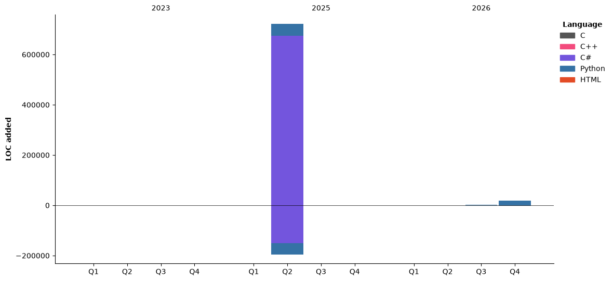

## Hi there 👋

🌐 **Portfolio:** [wxrstvrsn.github.io/wxrstvrsn](https://wxrstvrsn.github.io/wxrstvrsn/)

<!--
**wxrstvrsn/wxrstvrsn** is a ✨ _special_ ✨ repository because its `README.md` (this file) appears on your GitHub profile.

Here are some ideas to get you started:

- 🔭 I’m currently working on ...
- 🌱 I’m currently learning ...
- 👯 I’m looking to collaborate on ...
- 🤔 I’m looking for help with ...
- 💬 Ask me about ...
- 📫 How to reach me: ...
- 😄 Pronouns: ...
- ⚡ Fun fact: ...
-->
<!--START_SECTION:waka-->


**I'm a Night 🦉** 

```text
🌞 Morning                37 commits          ██░░░░░░░░░░░░░░░░░░░░░░░   06.03 % 
🌆 Daytime                144 commits         ██████░░░░░░░░░░░░░░░░░░░   23.45 % 
🌃 Evening                212 commits         █████████░░░░░░░░░░░░░░░░   34.53 % 
🌙 Night                  221 commits         █████████░░░░░░░░░░░░░░░░   35.99 % 
```
📅 **I'm Most Productive on Friday** 

```text
Monday                   95 commits          ████░░░░░░░░░░░░░░░░░░░░░   15.47 % 
Tuesday                  122 commits         █████░░░░░░░░░░░░░░░░░░░░   19.87 % 
Wednesday                100 commits         ████░░░░░░░░░░░░░░░░░░░░░   16.29 % 
Thursday                 62 commits          ███░░░░░░░░░░░░░░░░░░░░░░   10.10 % 
Friday                   127 commits         █████░░░░░░░░░░░░░░░░░░░░   20.68 % 
Saturday                 70 commits          ███░░░░░░░░░░░░░░░░░░░░░░   11.40 % 
Sunday                   38 commits          ██░░░░░░░░░░░░░░░░░░░░░░░   06.19 % 
```


📊 **This Week I Spent My Time On** 

```text
💬 Programming Languages: 
Python                   1 hr 21 mins        ████████████████████████░   97.53 % 
Markdown                 2 mins              █░░░░░░░░░░░░░░░░░░░░░░░░   02.44 % 
CSV/TSV                  0 secs              ░░░░░░░░░░░░░░░░░░░░░░░░░   00.01 % 
JSON                     0 secs              ░░░░░░░░░░░░░░░░░░░░░░░░░   00.01 % 
.env file                0 secs              ░░░░░░░░░░░░░░░░░░░░░░░░░   00.00 % 

🔥 Editors: 
PyCharm                  1 hr 23 mins        █████████████████████████   100.00 % 

🐱‍💻 Projects: 
VVP                      1 hr 21 mins        ████████████████████████░   97.30 % 
telegram-media-bot       2 mins              █░░░░░░░░░░░░░░░░░░░░░░░░   02.45 % 
TeleTorr                 0 secs              ░░░░░░░░░░░░░░░░░░░░░░░░░   00.25 % 

💻 Operating System: 
Mac                      1 hr 23 mins        █████████████████████████   100.00 % 
```

**I Mostly Code in C++** 

```text
C++                      15 repos            ████████████░░░░░░░░░░░░░   48.39 % 
Python                   7 repos             ██████░░░░░░░░░░░░░░░░░░░   22.58 % 
C                        5 repos             ████░░░░░░░░░░░░░░░░░░░░░   16.13 % 
C#                       3 repos             ██░░░░░░░░░░░░░░░░░░░░░░░   09.68 % 
HTML                     1 repo              █░░░░░░░░░░░░░░░░░░░░░░░░   03.23 % 
```


**Timeline**




 Last Updated on 06/11/2026 04:48:41 UTC
<!--END_SECTION:waka-->
